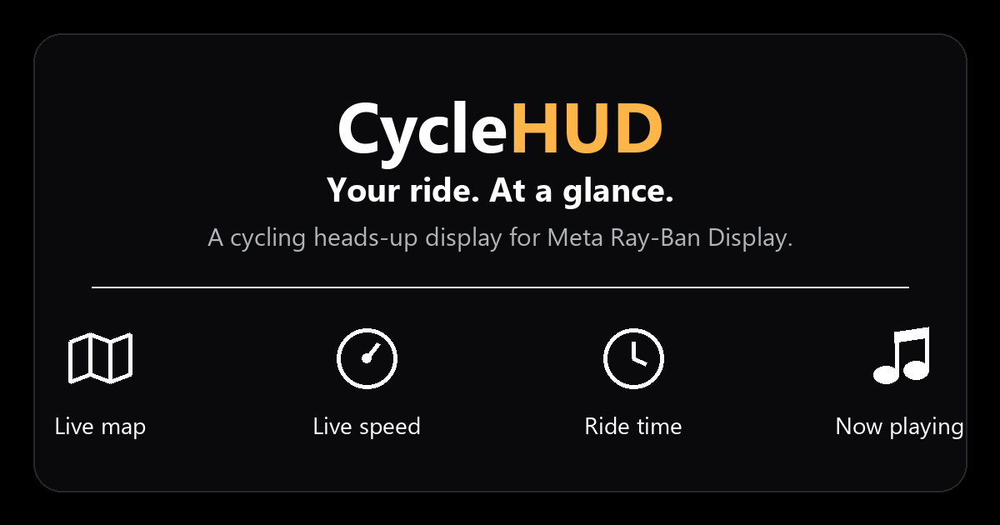
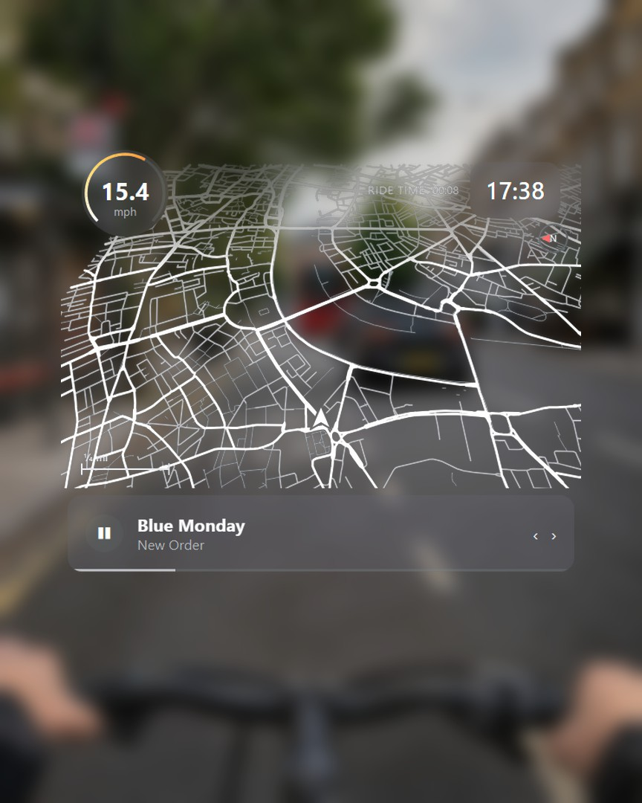
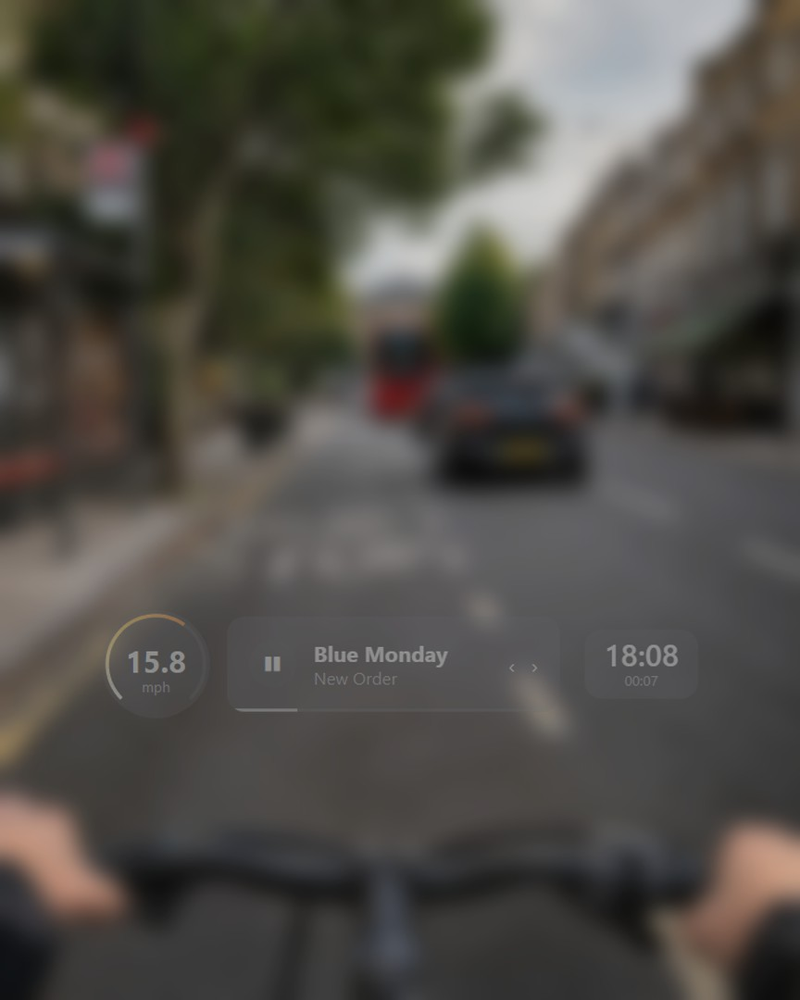
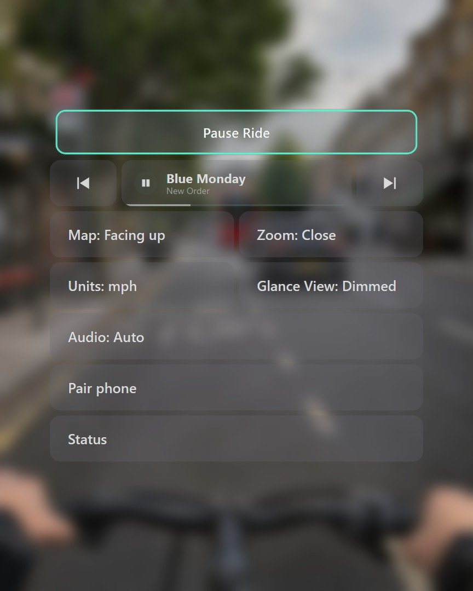
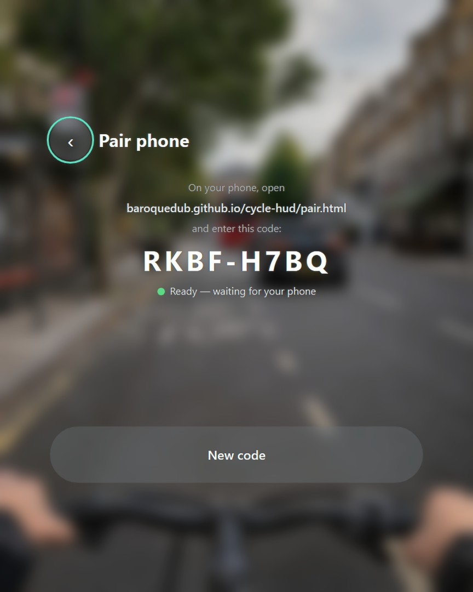

# CycleHUD

<p align="center"></p>

<table>
<tr>
<td width="40%"></td>
<td>

**Your ride, in view.** CycleHUD draws the streets around you and turns them to face the way you are riding, with no destination to type and no turn-by-turn nagging. **Map View** shows the road ahead with your speed, ride time and what is playing round the edges; **Glance View** drops the map for a quiet strip of speed, music and time. Pair your phone once to control Spotify or Plexamp from the glasses: tap to pause, swipe to skip.

Free and open source (AGPL). Map data from OpenStreetMap via OpenFreeMap. Spotify control needs Premium.

**Live map · Live speed · Ride time · Now playing**

Runs on **Meta Ray-Ban Display** glasses as a web app: nothing to install on your phone, no account to create.

</td>
</tr>
</table>

## Ride safely

CycleHUD is a glanceable display, not a navigator, and it cannot see the road. Keep your eyes on the road and your attention on traffic, pedestrians, surfaces and everything else around you. Glance at the display only when it is safe to, as you would at a bike computer, never while turning or in heavy traffic. Check the law where you ride before cycling with a display. You ride at your own risk: CycleHUD comes with no warranty and its author accepts no responsibility for accidents, injury, loss or damage arising from its use.

## Add it to your glasses

<table>
<tr>
<td width="30%"></td>
<td>

1. In the **Meta AI** app go to Settings and tap the app version number until **Developer Mode** appears.
2. Open your glasses' settings → **App connections** → **Web apps** → **Add a web app** and paste
   `https://baroquedub.github.io/cycle-hud/`
   (or scan this QR code with your phone camera: it opens the Meta AI app and offers to add it).
3. Open **CycleHUD** from the glasses' launcher and allow location when asked. The map works straight away.

</td>
</tr>
</table>

## On the ride

| Where | Controls |
|---|---|
| Map View / Glance View | **Select** switches between Map View and Glance View · **Up** toggles the zoom (Close / Wide) · **Down** opens the menu · **Left / Right** previous / next track · **Back** leaves the app |
| Menu | **Pause Ride** · the player: previous, now playing (press for play / pause), next · **Map** Facing up / North up · **Zoom** Close / Wide · **Units** mph / km/h · **Glance View** Dimmed / Bright · **Audio** Auto / Spotify / Plex / None · **Pair phone** · **Status** |
| Pause Ride | Ride time, average speed and distance (moving time only) with the player (**Left / Right** skip) · **Select** resumes · **Back** asks before you quit |

<table>
<tr>
<td width="33%"></td>
<td width="33%"></td>
<td width="33%"></td>
</tr>
<tr>
<td align="center">Glance View: speed, music and time, nothing else.</td>
<td align="center">One menu: pause the ride, play, skip, map, zoom, units.</td>
<td align="center">Pair your phone once.</td>
</tr>
</table>

- **Facing up** rotates the map so the direction you have just moved points up the screen; **North up** keeps the map still and turns the arrow. The map holds its heading while you wait at a junction and picks the new direction up within a few metres of moving off.
- Speed and ride time come from the phone's GPS. The speed dims after 5 s without a fix and shows `--` after 15 s. Ride time counts moving time only, so waiting at lights does not add to it.
- **Pause Ride** (top of the menu) freezes the ride time and shows your moving-time figures: ride time, average speed and distance. Select resumes, straight back to whichever view you were in. Figures start from zero each time the app is opened.
- The music bar shows what is playing on Spotify (any device) or Plexamp, with a progress line along its bottom edge; the round glyph is the play state (bars bounce while playing). **Audio: Auto** (the default) shows whichever one is playing; **Audio: None** hides the bar in both views.
- Glance View is dimmed so it sits quietly in your view; **Glance View: Bright** in the menu turns that off.

## Pair your phone (needed for music)

On the glasses press **Down** for the menu and choose **Pair phone**: it shows a web address and an 8-character code. On your phone open `https://baroquedub.github.io/cycle-hud/pair.html`, type the code and press **Pair**. The glasses say "Phone paired".

The code is your private channel: only someone who knows it could send settings to your glasses. Press **New code** on the glasses whenever you want a fresh one.

### Spotify (Premium needed for the controls)

Spotify only lets a hobby app control the account of the person who registered it, so you register a free app of your own. It takes five minutes and is done once.

1. Go to [developer.spotify.com/dashboard](https://developer.spotify.com/dashboard), sign in and press **Create app**. Name it "CycleHUD". For **Redirect URI** paste the address shown in the Spotify box on the pair page and press **Add**. Tick **Web API** and save. Copy the app's **Client ID**.
2. Back on the pair page, paste the Client ID into the Spotify box. Make sure CycleHUD is open on the glasses, press **Connect Spotify** and approve.

The glasses say "Spotify connected" and the bar shows what is playing on any of your Spotify devices. The sign-in renews itself on the glasses; nothing is stored anywhere else.

### Plex / Plexamp (optional)

You need your own Plex Media Server with **Remote Access** on. The Plex box on the pair page explains where to find the server's secure `plex.direct` address and your token. Paste both, press **Test** while Plexamp is playing (it should name the track), then **Send to glasses**.

Now-playing comes from the server; play, pause and skip are relayed through it to Plexamp. If your server or player does not accept that, the bar still shows what is playing and the glasses say "Plex: control unavailable" when you try to skip.

## Troubleshooting

- **Location blocked**: allow location for web apps in the Meta AI app, then reopen CycleHUD.
- **Music bar says "Spotify not connected" (or Plex) after pairing**: pairing only opens the channel between phone and glasses. Open the pair page on the phone and press **Connect Spotify** (or **Send to glasses** for Plex); the glasses say "Spotify connected" within a few seconds.
- **Reinstalled the app under a new address?** Each web app has its own storage on the glasses, so pair the phone and connect your music again.
- **"Reconnecting…" on the music bar**: the phone is offline or asleep; it recovers by itself.
- **Plex says "player not in server client list"**: bring Plexamp to the foreground on your phone.
- **Spotify or Plex forgotten after a glasses update**: open the pair page and press **Connect Spotify** / **Send to glasses** again.
- **Which build is this?** Menu → **Status** shows the version, the location and map state, and what each music source is doing.

## Privacy

CycleHUD has no accounts and no server of its own. It is a static page served from GitHub Pages. Your location never leaves the glasses except to fetch the map tiles around you (OpenFreeMap, by tile, not by position). Spotify and Plex tokens are stored only on the glasses. The pair page talks to the glasses through a private [ntfy.sh](https://ntfy.sh) topic named by your pairing code; messages are held there for up to 12 hours so the glasses can collect them even if they were asleep, which is why the code should stay private.

<details>
<summary><b>For developers</b>: how it works, testing on a laptop, hosting your own copy</summary>

### How the heading works

In Facing up the map is rotated so that the direction the bike has just moved points up the screen: the heading is the bearing of your own track over the last dozen metres (fine-tuned to the road it runs along), held when you stop, and picked up again within a few metres of moving off. The glasses' compass is on your head, not the bike, so it never steers the map while riding; once it has calibrated itself against the track it orients the map when the app opens and, at a stop, only after a sustained turn of more than 70 degrees held for several seconds (turning the bike round), never for a glance. The fix's `heading` field is never trusted (the glasses put 0 in every fix). Status → **Send ride log** publishes every fix the app saw to the pair page for replay with `index.html?replay=URL`.

Road data is OpenStreetMap, delivered as [OpenFreeMap](https://openfreemap.org) vector tiles (free, no account). The 3×3 tiles around you (about 4.5 km) are kept loaded and the next ones are fetched as you cross into a new tile; the last set is cached on the glasses so the map draws immediately on the next launch. If a tile can't be fetched, the same area is asked from the Overpass API instead.

Built for the glasses' 600×600 additive display (black is see-through), Neural Band / temple-swipe input (arrow keys + Select), phone-sourced `navigator.geolocation`, and a plain static site: no build step, no framework, no server.

### Testing on a laptop

Serve the folder (for example `python -m http.server 8000` inside it) and open `http://127.0.0.1:8000/index.html?demo` in Chrome with the device toolbar set to 600×600. The demo rides a 2 km loop around Trafalgar Square. Use the arrow keys and Enter for the Neural Band, Escape for Back.

- `&start=LAT,LON` starts the loop somewhere else; `&speed=10` sets the riding speed in metres per second. Degradations for the heading estimator (`&noheading`, `&sparse=N`, `&noise=M`, `&late`, `&nots`, `&jump`, `&pause=N`) are described at the top of `geo.js`.
- `?replay=URL&rate=R` plays a ride log back with the app's clock running at R× real time.
- `pair.html` works from the laptop too, so you can pair, connect Spotify and watch the bar update without the glasses. For Spotify's redirect add `http://127.0.0.1:8000/pair.html` as a second redirect URI in your Spotify app settings (Spotify requires HTTPS or 127.0.0.1).

### Hosting your own copy

1. Fork this repository (or create a new **public** one and push this folder to it, including the hidden `.well-known` folder and the `.nojekyll` file).
2. **Settings → Pages → Source: Deploy from a branch → main / (root) → Save.**
3. After a minute the app is live at `https://YOUR-USER.github.io/YOUR-REPO/`. Add it on the glasses as above. The pair page and the Spotify redirect URI follow the new address automatically.

`.nojekyll` matters: without it GitHub Pages hides the `.well-known` folder, and the glasses won't find the app's name and icon.

### Files

```
index.html                   glasses screens (map, menu, pause, quit, pair, status) + media bar + splash
styles.css                   styles for the additive display
config.js                    non-secret settings (tile source, relay, zoom steps, units, version)
geo.js                       geo maths, location watch, demo rider + ride replay, compass (launch only), Motion: track → heading
mvt.js                       minimal Mapbox Vector Tile decoder
map.js                       tile loading/caching (OpenFreeMap, Overpass fallback) and canvas drawing
relay.js                     ntfy.sh listener for messages from pair.html (and ride-log upload the other way)
media.js                     media bar, polling, marquee, progress line, controls
media-spotify.js             Spotify Web API source (PKCE refresh)
media-plex.js                Plex Media Server source
pair.html                    phone companion page (pairing, Spotify sign-in, Plex setup, ride logs)
docs/                        README images (card, screenshots, icon, QR)
favicon.png / manifest.webmanifest / icons/icon.svg / .well-known/meta-wearables-manifest.json
.nojekyll                    lets GitHub Pages serve .well-known
```

</details>

## Licence

Copyright (C) 2026 baroquedub. CycleHUD is free software: you can redistribute it and modify it under the terms of the [GNU Affero General Public License v3.0 or later](LICENSE). It comes with no warranty. If you run a modified copy for other people to use over a network, the AGPL requires you to offer them its source code. Releases up to 0.8.2 (published as "Cycle Hub") were under the MIT licence.

Map data © [OpenStreetMap](https://www.openstreetmap.org/copyright) contributors, tiles by [OpenFreeMap](https://openfreemap.org) © [OpenMapTiles](https://www.openmaptiles.org/). Spotify and Plex are trademarks of their owners; CycleHUD is not affiliated with Meta, Spotify or Plex.
